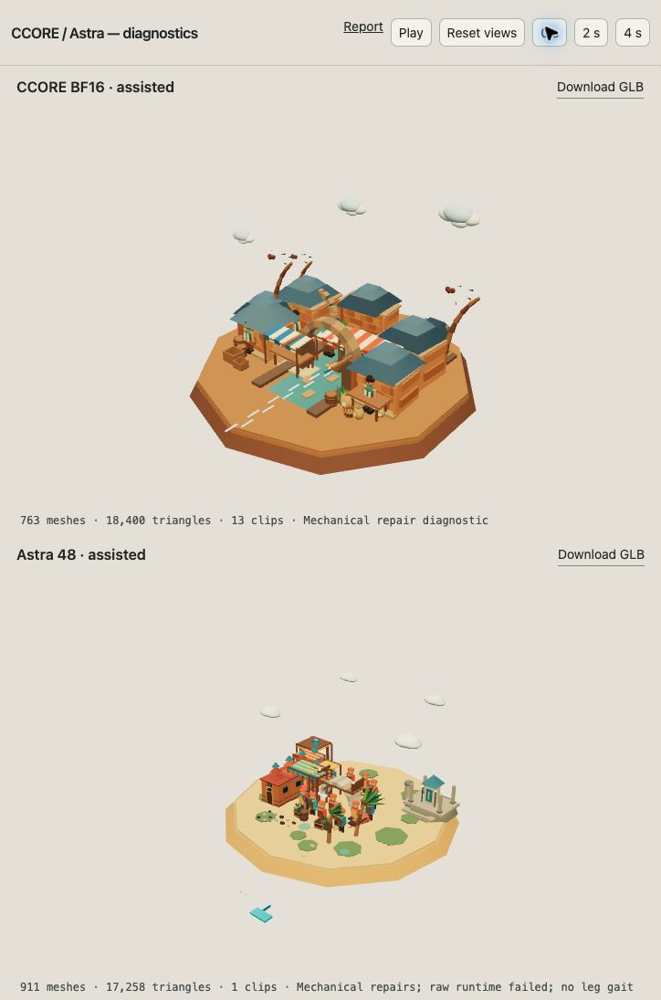
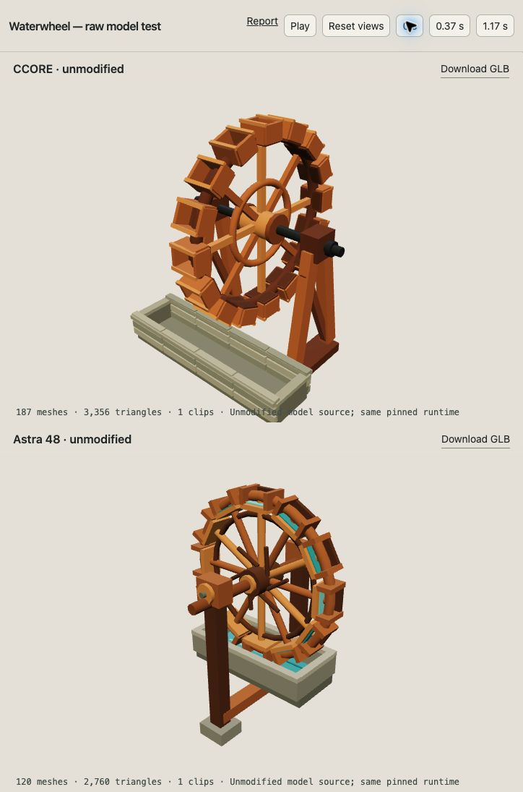
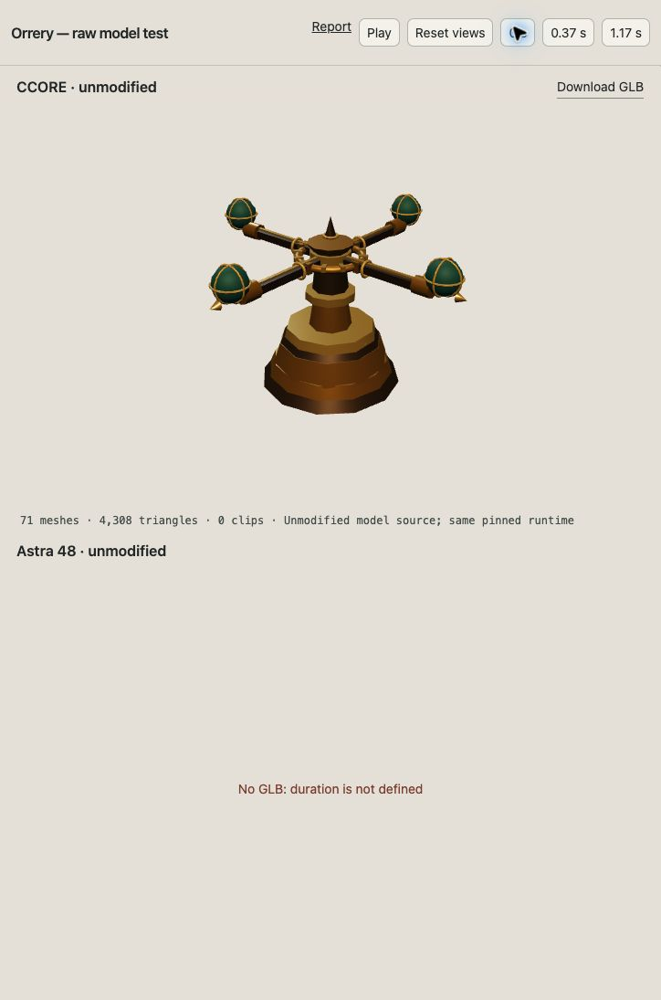

# Astra overnight experiment — final result, November 17, 2026

**Astra did not demonstrate a higher-quality Babylon marketplace than CCORE.** No trained checkpoint passed the primary task as an unmodified model-generated export. The selected Thinking48 checkpoint produced a mechanically repaired diagnostic with more visible people than earlier Astra attempts, but its layout, canal, walking and overall composition remained deficient. The later 72-update checkpoint regressed syntax and was rejected. CCORE remains the reference; there is no accepted replacement model.

The two final held-out tasks produced a **mixed, narrowly scoped result**. Astra exported a waterwheel with the correct axle rotation where the control's exported wheel rotated off-axis. On the orrery, CCORE exported a static model with no requested animations, while Astra stopped with a runtime error and exported nothing. This pair does not override the failed primary objective or establish a broad quality gain.

The authorized experiment window began **20:42:39 EST on November 16** after the owner's immediate-start clarification and ends **07:42:39 EST on November 17**. That is an eleven-hour experiment budget, **not eleven hours of continuous training**. Successful controller training jobs occupied **74.65 minutes**, including their setup, validation and checkpoint overhead.

## Primary Babylon result

The unchanged [Babylon prompt](../eval/prompts/babylon-marketplace-v3.txt) required a coherent detailed market, at least sixteen villagers with convincing walking/trading, water/cloud movement, and animation surviving GLB export. HTML completion, lower loss, mesh count and clip presence were not acceptance criteria by themselves.

| Evidence | Raw model result | Actual repaired export/reimport | Review outcome |
| --- | --- | --- | --- |
| Fresh BF16 CCORE control | Syntax/runtime defects; no raw success | 2,040,220-byte GLB; 13 clips, 35 channels; validator 0 errors/0 warnings | More coherent multi-building composition, but only six villagers, no leg walking and disconnected palm fronds. A repaired reference, not a successful raw baseline. |
| Thinking48, selected for final tests | Syntax passes; runtime fails on undefined `object.name` in `quaternionTrack` | 2,198,120-byte GLB; 911 mesh definitions, 1,014 nodes, 42 materials; one 106-channel clip; validator 0 errors/0 warnings | Sixteen actors translate with static legs and path snaps. Sparse composition, collapsed/missing canal and a stray water piece. Overall not better than CCORE. |
| Thinking72, later rejected branch | Syntax fails at malformed `function能得到Path(index)` declaration | 1,977,836-byte GLB; 736 mesh definitions, 808 nodes, 552 materials; one 66-channel clip; validator 0 errors/0 warnings | Seventeen actors, no leg tracks, clustered placement, route pauses/snaps and water extending outside the plinth. Overall worse; training was stopped. |

Thinking48 assistance corrected object/array/tuple wiring, quaternion representation, one undefined material reference, the existing zero-progress path endpoint and a repeated scale array. Eight unresolvable sway tracks were omitted. Thinking72 assistance corrected a function token and actor references and omitted ten incomplete or misbound tracks while preserving downstream random draws. Neither diagnostic introduced geometry, gait, new curves or smoothing. **These assisted assets are not raw passes and their benchmark-derived repairs were not training examples.**

Mesh counts in the table are GLB mesh definitions. Viewer overlays may count rendered mesh instances instead; the two counts need not match.

The side-by-side GLBs were reopened in Chrome with common lighting, camera and normalized framing and inspected at zero and four seconds. The screenshots are evidence of those sampled states, not a substitute for continuous playback or owner acceptance.

Download and inspect the [Thinking48 diagnostic](../eval/checkpoints/astra-thinking48-diagnostic/README.md), [rejected Thinking72 diagnostic](../eval/checkpoints/astra-thinking72-diagnostic/README.md), and [matched BF16 control diagnostic](../eval/baselines/babylon-bf16-20261116/README.md). The [historical native CCORE reference](../eval/baselines/babylon-20261116/README.md) remains separate and retains its repair label.

## Frozen final evaluation

Thinking48 was selected **before any final task output was seen**. Its immutable adapter SHA-256 is `553644f2a1d85c06642484f327b657eca0cf8e7516a874ca1182ed6b9720ab66`. Selection meant “candidate to evaluate,” not “accepted quality checkpoint.” All controller `best_checkpoint` fields remained null.

The two prespecified tasks used untouched CCORE BF16 and the same base with Thinking48, with identical per-task system/user messages and prompt-token hashes. Both arms used thinking enabled, seed 42, a 32,768-token limit, temperature 0.8, top-p 0.95 and top-k 40. Runtime versions were MLX 0.32.4, MLX-LM 0.32.2 and Transformers 5.23.0. There were no task-source repairs and no weight updates after the candidate freeze. The common browser staging adapted dependency URLs/frame caps, not asset geometry or animation.

| Final task | CCORE raw result | Thinking48 raw result | Meaning |
| --- | --- | --- | --- |
| Waterwheel | Actual GLB export/reimport, validator 0 errors, one clip. Quaternion construction changes the wheel's axle direction. | Actual GLB export/reimport, validator 0 errors, one clip. Rotation stays on its authored axle. | Narrow motion-reliability improvement in this one pair. |
| Orrery | Actual GLB export/reimport, validator 0 errors, **zero clips**: the clip builder was never invoked. | Browser `ReferenceError: duration is not defined`; no GLB. A second incorrect `AnimationAction` call is also present in source. | Astra regressed export reliability; neither fulfills the requested animated task. |

The actual waterwheel GLBs were checked at 0, 0.37 and 1.17 seconds. Control axle drift was **0°, 16.65° and 52.65°**; Astra's was **0° at all three samples**. Expected local axes come from each source's axle geometry. This numerical check corroborates the observed motion problem rather than treating validator success as correct motion. The common viewer fits both assets from animation time zero; the earlier capture-pose fit remains private historical evidence.

All four generations finished normally: waterwheel control/Astra generated 18,952/17,228 tokens in 287.01/269.15 seconds; orrery control/Astra generated 16,110/16,485 tokens in 243.40/255.87 seconds. Reported generation peaks were 9.14–9.22 decimal GB. Completion did not imply executable code or correct animation.

The [final artifact directory](../eval/final-tests/overnight-20261117/README.md) contains all four original sources, three actual GLBs, validation/export receipts, failure evidence, screenshots and the axis audit. The final scope is **two tasks and one seed**, not the proposed broader benchmark. The documented filtering holds these tasks out of the added training data; absence from upstream pretraining is unknown.

## Training accounting and candidate identity

| Controller run | Completed updates | Corrected real target exposures | Successful training-job wall time | Peak reported MLX memory |
| --- | ---: | ---: | ---: | ---: |
| Initial thinking/reasoning approach | 65 | 517,688 | 549.70 s | 51.255 GB |
| Direct-code variants and correction phase | 424 | 3,313,847 | 2,469.98 s | 29.901 GB |
| Fresh thinking approach, including the rejected later branch | 85 | 1,522,023 | 1,459.53 s | 51.269 GB |
| **Total controller work** | **574** | **5,353,558** | **4,479.22 s / 74.65 min** | **51.269 GB** |

The original reported target counter was 5,354,035. Removing **477 legacy padding labels** yields 5,353,558 real target exposures. These are repeated training exposures, not unique corpus tokens. Corrected `exclusive_end_v1` jobs need no subtraction. The update-loop timers total 54.16 minutes; validation timers total 15.91 minutes and are already included in job wall time. Aborted attempts add 6.19 minutes with zero confirmed updates. MLX peaks are decimal GB, not RSS/GiB or proof of an OS memory cap.

Separately receipted numerical and qualification branches performed **at least 19 optimizer updates**. That inventory is nonexhaustive; do not label `574 + 19` a complete total or add those forks to the selected checkpoint. Only three separately documented external rank-16 length updates entered the historical direct-code lineage; **none entered Thinking48**.

Thinking48 inherited exactly **48 main updates and 987,295 real target exposures**, from two 24-update jobs. Its ten short and three length qualification updates were separate adapters. The first main job's saved resume path is null. It is **not a 51-update model**. The [frozen v2 plan](../eval/final-evaluation-plan-v2.json) incorrectly recorded three inherited length updates; that historical file is preserved with the [explicit accounting correction](../eval/final-evaluation-accounting-correction.json). Candidate bytes, test prompts, mode, sampler and order did not change when this metadata was corrected.

The selected model uses fresh rank-16 LoRA on the final attention layer, learning rate `3e-6`, batch size one, AdamW, a 32,768-token maximum sequence and the corrected target mask. Main training used 399 original full reasoning-plus-code CCORE examples, without short-helper or correction-example mixing. Frozen-prefix inference reduced memory pressure; optimizer/sampler state restarted between segments while adapter weights resumed. The selected main jobs took 923.48 seconds together and peaked at 47.576 reported MLX GB. Original CCORE weights were preserved; no model weights are included in this public evidence package.

The [sanitized accounting summary](../eval/results/overnight-controller-accounting-20261117.json) distinguishes all controller work from inherited model updates. The [machine-readable final results](../eval/results/overnight-20261117.json) link outcomes, artifact hashes and the frozen selection.

## What the failures established

The initial 42-main-update approach exhausted the showcase token budget without a usable HTML scene. The direct-code 200-update output produced more code but failed syntax/export; its assisted export was static and visually worse. The 300-update follow-up degenerated into repeated calls and was stopped. A two-layer training proposal exceeded the memory floor during length qualification and was rejected with zero completed updates. Rank expansion and twelve verified full-program corrections did not produce a raw Babylon success. The fresh thinking interface produced the closest diagnostic, then syntax regressed after another 24 updates.

An audit found all 448 retained replay scripts syntactically valid and no obvious pseudocode placeholders, but one target created animation without passing it to the exporter. A supplied GLB hash/validator receipt does not prove that its paired source executes or fulfills the task. Earlier title-only split checks also missed reserved components; later full-field lexical exclusions and grouped splits improved the gate without proving semantic independence. The leaked bellows probe remains diagnostic evidence, not a clean final test.

These observations support improving source execution/export supervision, preserving the original thinking interface during controlled comparisons, and using fixed development checks. They do **not** identify a single proven cause of the quality failures or justify further training on this run's held-out outputs.

A separate repair-interface check of the older direct-code correction checkpoint also failed: base code duplicated `exportButton`, and the corrected checkpoint produced a 15-byte `[object Object]` download. That check is **not an independent final task and not a Thinking48 result**; it is supplementary evidence against claiming that the historical correction phase solved export reliability.

## Deliverables and limits

This report fulfills the scientific outcome requirement with an explicit negative primary result, actual exported/reopened diagnostics, unmodified final-test sources, failure evidence and corrected accounting. It does not claim that the primary quality objective was achieved. There is no usable **raw** Astra Babylon GLB; the linked Thinking48 Babylon file is explicitly assisted.

The operational handoff records the owned-job shutdown, paused localhost comparison, private checkpoint preservation/backup and source publication status. Those actions must be verified separately; neither this report nor a local artifact proves a remote push or backup. No deployment, project-main merge, paid service, model-weight publication or additional training is part of this report.

The final gallery was browser-verified with the actual GLBs, including Babylon seeks, the waterwheel axis comparison, the orrery failure and historical screenshots. It remains paused and renders on demand; the browser GPU lease was released. A supervision gap is retained explicitly: the earlier final-export browser lease expired at **06:00:08 EST**, while fixture-browser review continued until approximately **06:04**, then closed. No overlapping GPU job was observed, but this interval is not claimed to have been covered by a valid lease.

Final repository checks reported **98 Python tests total: 96 passed and two MLX-dependent tests skipped**, plus **8/8 Node tests**, **20 passing CPU preflight checks without starting training**, and passing JavaScript syntax/diff checks. Earlier native MLX qualification evidence is separate from those skipped tests. These engineering checks do not replace the recorded asset failures or establish owner acceptance.

The evidence contains generated evaluation sources/assets and reviewed screenshots, not training corpora, private account identifiers, service credentials or model weights. Dependency imports retain their upstream URLs. Artifact manifests record file sizes and SHA-256 hashes; repair patches and original sources make assistance reviewable.
