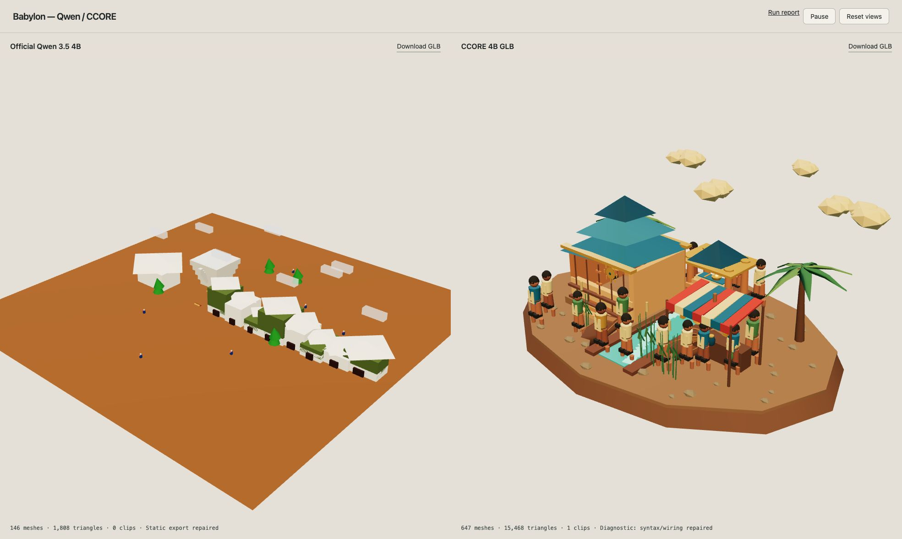

# Frozen visual baseline — 2026-11-16

| Stage | Model | Saved output |
| --- | --- | --- |
| Official upstream | Qwen/Qwen3.5-4B | [GLB](official-qwen.glb) |
| Existing 3D specialization | ccore/Qwen3.5-4B-GLB-3D-Coder | [GLB](ccore.glb) |
| Our future specialization | CCORE plus our LoRA | **Not trained; no output yet** |

These are frozen repaired diagnostic exports, not clean one-shot passes. Official is static; CCORE has partial motion, fifteen people and no walking-leg tracks. Screenshot shows the exported/reimported GLBs with common viewer lighting and normalized framing. See [full results](../../../docs/comparison-results.md), [prompt](../../prompts/babylon-marketplace-v3.txt), [settings](../../../configs/comparison-v1.json) and [receipt](../../results/babylon-20261116.json). File integrity is recorded in manifest.json. Generated code uses unseeded browser randomness: the saved GLB is the canonical frozen output; re-executing HTML can produce a different scene despite the fixed model sampling seed.

Original model-authored HTML and the exact served repaired variant are retained alongside the exports. Treat these HTML files as untrusted generation evidence; inspect before execution. Dependencies and 60fps cap are separate staging adaptations. No additional assets or new motion curves were inserted. Earlier failures remain documented in the full results.

Credit: Qwen team for official checkpoint; ccore for the GLB specialization (model card declares Apache-2.0). Generated outputs are evaluation examples, not newly claimed hand-authored artwork. Dependencies retain their own licenses. These files contain no model weights. Preserve attribution and this qualification when sharing.

Keep this task, near-duplicates, outputs and targeted corrections out of training. Future third-panel results must identify model/adapter revisions, seed, runtime, repair status and training cutoff. Use identical conditions and compare on independent held-out tasks too. Do not overwrite these files with future model output.
