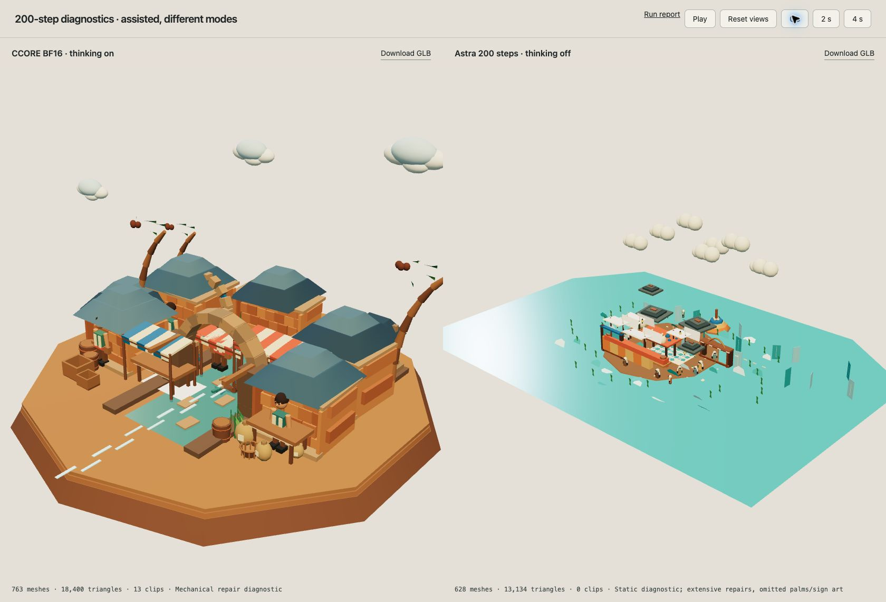

# 200-step Astra diagnostic

This is a failed early checkpoint, not an improved model. The raw generated HTML contains pseudocode and syntax/runtime/export errors. The separate static diagnostic interprets and repairs implementation errors, omits ambiguous palms and missing sign artwork, and uses a standard static exporter. No new motion or decorative geometry was added. The patch and complete raw source are retained.

The diagnostic GLB was actually exported and reopened in Chrome: 1,603,028 bytes, 628 mesh definitions, 742 nodes, 64 materials, and **zero animation clips**. Khronos validation reported zero errors and warnings; that does not establish quality.

The screenshots compare this no-thinking Astra diagnostic with the fresh thinking-on BF16 CCORE repair diagnostic. The exact user prompt is the same, but generation modes and assistance differ. This is not a matched causal comparison. Shared viewer lighting and normalized-bound framing expose the candidate's oversized water plane, floating parts, and small central market. Astra is static at both times; CCORE water/cloud placement changes. The candidate looks worse.

Three embedded CCORE textures failed to load during these first captures. The server's blob-fetch policy was corrected afterward; these original captures remain labeled and are not claimed texture-complete. Reverification is pending. Neither this diagnostic nor its repairs enter training.

The 300-step follow-up was subsequently aborted after thousands of repeated function calls and has not been accepted either. Current experiment status remains in the rolling HANDOFF and overnight run record.

