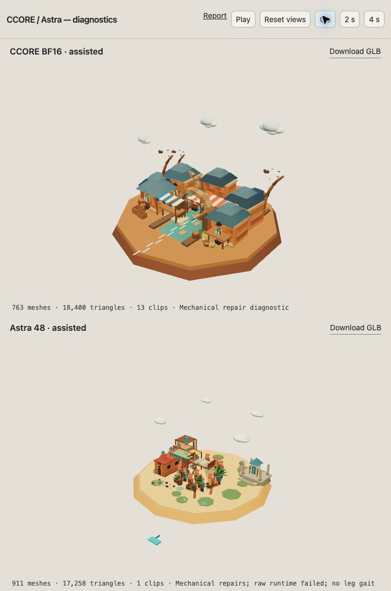
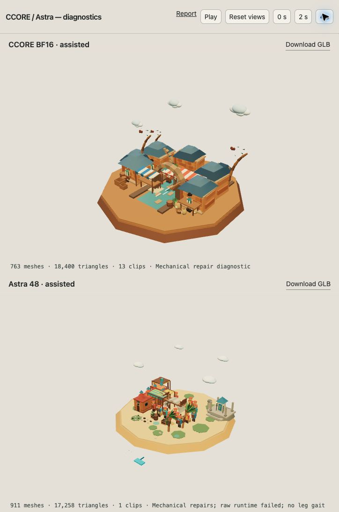

# Thinking48 Babylon diagnostic

**Mechanically assisted; raw model failure.** This checkpoint was selected for frozen final tests, not quality-accepted. It inherits 48 main updates only; qualification adapters were separate.

The raw source passes syntax but fails at undefined object.name in quaternionTrack. The assisted diagnostic has sixteen actors, one 106-channel clip, static legs, path snaps, sparse composition and a collapsed canal. Eight unresolvable sways were omitted. It was judged overall not better than CCORE.

[Original model HTML](original.html), [assisted HTML](generated.html), [exact repair patch](repair.patch), [actual GLB](asset.glb), [validator receipt](asset.glb.validation.json), [review](visual-review.json), and [provenance](provenance.json) are retained. The actual GLB was exported and reopened in Chrome, with zero validator errors/warnings. That establishes file validity within the validator's scope, not visual quality or correct gameplay motion.

The provenance separates the original CPU preparation record from the subsequent actual browser review. No new geometry, gait, curves or smoothing was inserted. Benchmark-derived repairs were never training examples. These are repaired outputs on both sides of the comparison; neither is a raw success.

The screenshots use the [fresh BF16 repaired CCORE control](../../baselines/babylon-bf16-20261116/README.md), common camera/lighting/normalization, and seeks at 0/4 seconds. The historical native CCORE reference is separately preserved.

See the [final report](../../../docs/overnight-final-20261117.md) for the experiment outcome. No model weights or training corpus are included.
