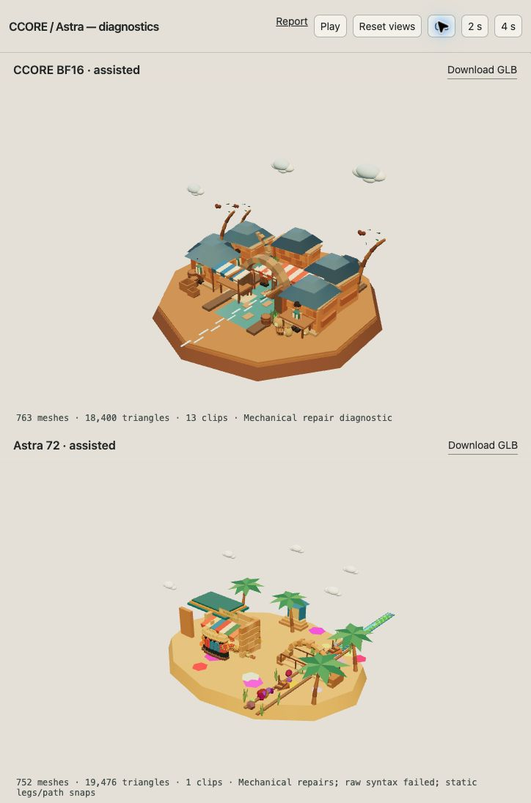
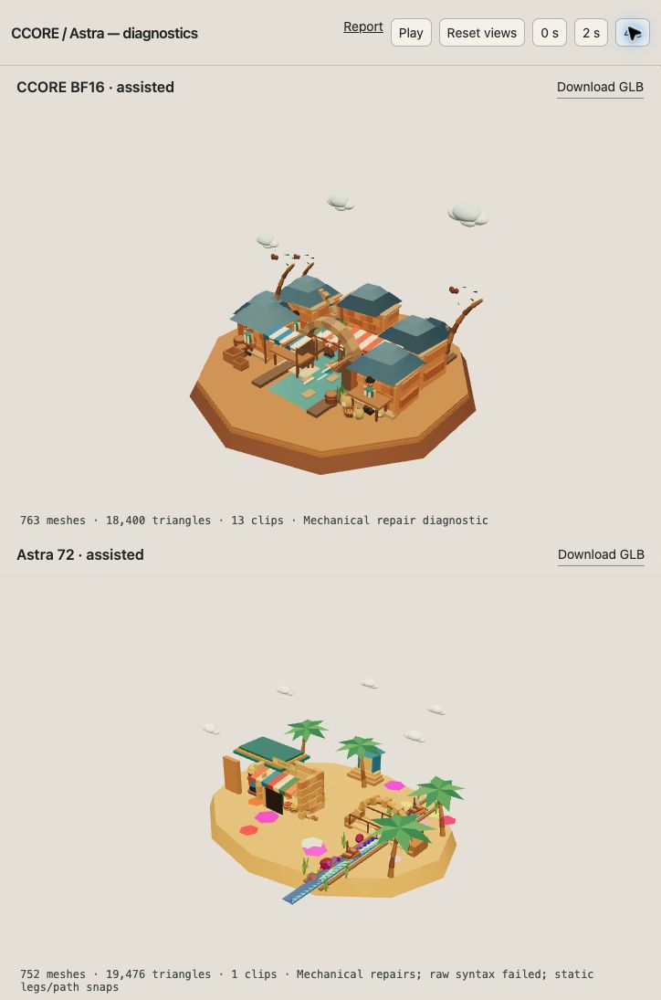

# Thinking72 Babylon diagnostic

**Mechanically assisted; raw model failure.** This checkpoint was later rejected regression, not selected for final tests. It inherits 72 main updates only; qualification adapters were separate.

The raw source fails syntax at function能得到Path(index). The assisted diagnostic has seventeen actors, one 66-channel clip, static legs, clustered placement, route pauses/snaps and water beyond the plinth. Ten malformed/unresolvable tracks were omitted, preserving downstream random draws. It was judged overall worse than CCORE and the branch was stopped.

[Original model HTML](original.html), [assisted HTML](generated.html), [exact repair patch](repair.patch), [actual GLB](asset.glb), [validator receipt](asset.glb.validation.json), [review](visual-review.json), and [provenance](provenance.json) are retained. The actual GLB was exported and reopened in Chrome, with zero validator errors/warnings. That establishes file validity within the validator's scope, not visual quality or correct gameplay motion.

The provenance separates the original CPU preparation record from the subsequent actual browser review. No new geometry, gait, curves or smoothing was inserted. Benchmark-derived repairs were never training examples. These are repaired outputs on both sides of the comparison; neither is a raw success.

The screenshots use the [fresh BF16 repaired CCORE control](../../baselines/babylon-bf16-20261116/README.md), common camera/lighting/normalization, and seeks at 0/4 seconds. The historical native CCORE reference is separately preserved.

See the [final report](../../../docs/overnight-final-20261117.md) for the experiment outcome. No model weights or training corpus are included.
