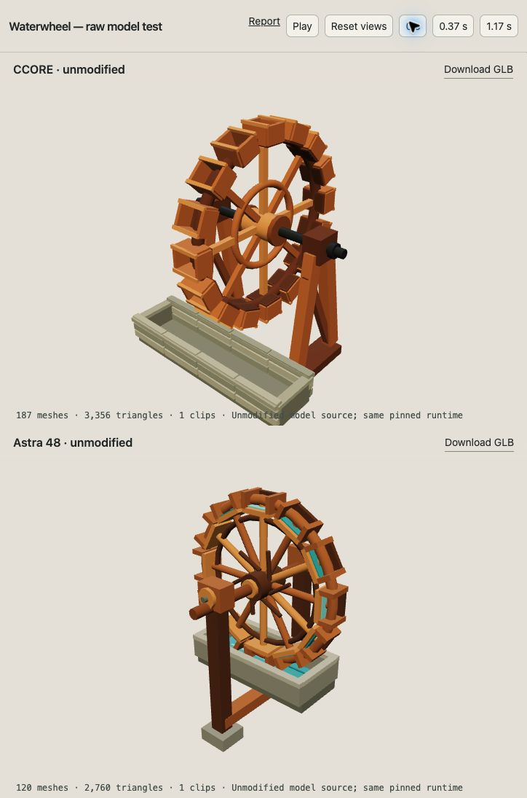
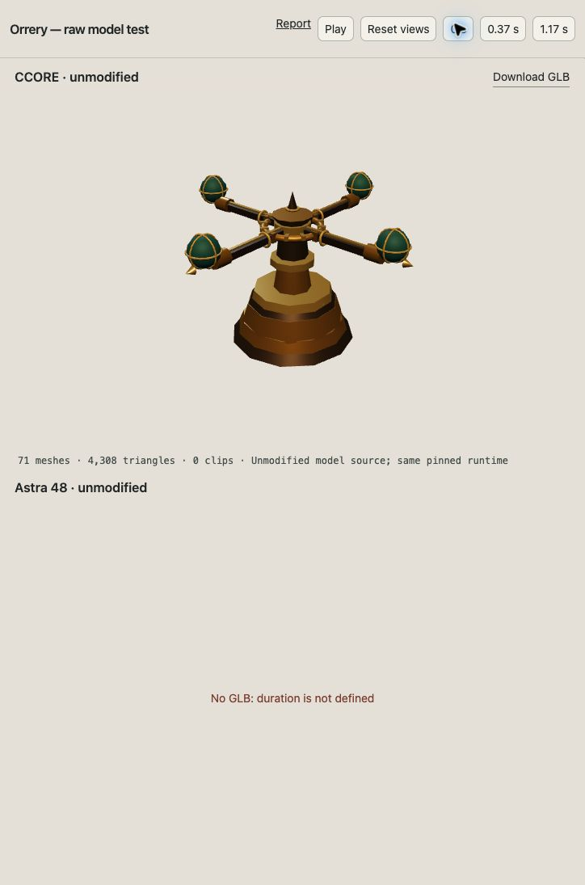

# Final held-out evaluation — November 17, 2026

**Mixed results; no broad quality win.** Thinking48 was frozen before these outputs. Both arms used the same task prompt, seed 42, thinking enabled, BF16 runtime and sampler. None of the four generated programs was repaired. Browser staging only localized dependencies and capped frames; the original sources are retained byte-for-byte.

| Task / arm | Original source | Actual GLB | Outcome |
|---|---|---|---|
| Waterwheel / CCORE | [HTML](waterwheel-control/original.html) | [GLB](waterwheel-control/asset.glb) | One clip, validator 0 errors/warnings; wrong axle rotation. |
| Waterwheel / Astra48 | [HTML](waterwheel-astra/original.html) | [GLB](waterwheel-astra/asset.glb) | One clip, validator 0 errors/warnings; correct axle rotation. |
| Orrery / CCORE | [HTML](orrery-control/original.html) | [GLB](orrery-control/asset.glb) | Static, zero clips despite requested animation; validator 0 errors/warnings. |
| Orrery / Astra48 | [HTML](orrery-astra/original.html) | None | Browser ReferenceError: duration is not defined. |

Each arm includes generation/syntax/results receipts. Existing GLBs have actual export receipts and Khronos validator reports. All three downloaded files were reopened in the common viewer. `waterwheel-axis-audit.json` measures the actual exported axle orientation at 0, 0.37 and 1.17 seconds. Screenshots show common time-zero fitted bounds, camera and lighting; they do not substitute for motion review. The paired test prompts are included.

The [final report](../../../docs/overnight-final-20261117.md) explains protocol, primary-task failure, corrected training accounting and limits. The candidate SHA/selection precedes these tests; there were no post-test updates. Two tasks/one seed do not establish broad generalization. No assertion is made about absence from upstream pretraining.

Sources and assets were generated for this experiment. No model weights, raw training corpora or third-party asset packs are included. The HTML imports Three.js; no vendor bundle is redistributed here. The package makes no new blanket license claim over dependencies or model outputs.

The orrery 1.17-second screenshot predates the explicit failure-label correction: its blank Astra pane reflects the runtime failure, not an empty exported asset. The corrected zero-second screenshot and runtime-failure receipt are authoritative for that status.
